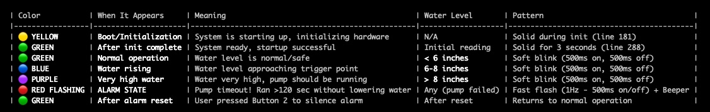

# Sump Monitor Controller
**ESP32-S2 Version for Adafruit Feather ESP32-S2 TFT**

## Overview
Automatic sump pump controller with water level monitoring, timeout protection, and alarm system.

## Hardware Requirements
- **Adafruit Feather ESP32-S2 TFT** (240x135 ST7789 display, built-in NeoPixel DISABLED)
- **ADS1115** 16-bit ADC module (I2C)
- **0-10V Water Level Sensor** with voltage divider (20kΩ, 10kΩ, 2.2µF cap - see QuickConnections.txt)
  - See Amazon for example: https://a.co/d/4JelvCt (QDY30A 0-10V 1M sensor)
- **5V Relay Module** (active-high) for pump control
- **2x Additional 5V Relay Modules** (GPIO 12, GPIO 13) - optional, not auto-controlled
- **Piezo Beeper**
- **2 Push Buttons** (NO, momentary)
- **2 GPIO Inputs** (GPIO 14/A4, GPIO 8/A5) with internal pullups
- **External NeoPixels** on GPIO 11 (2 pixels) - primary status indicator

## Features
- **Automatic Pump Control**: Turns pump on at 5" water level, off at 2"
- **No Sensor Offset**: Sensor offset set to 0.0" (adjust SENSOR_OFFSET_INCHES if needed)
- **No Averaging**: Uses current sensor reading directly (instant response, updates every 2 seconds)
- **Debug Control**: Serial output controlled by single flag (enaDbgSer: 0=silent, 1=verbose)
- **OTA Updates**: Wireless firmware updates via Arduino IDE (uses DHCP - recommend router reservation)
- **Timeout Protection**: 4-minute maximum runtime with pause/restart logic
- **Extension Run**: Pump runs 20 seconds after reaching off-level to ensure complete drain
- **High Water Alarm**: Triggers at 10" with beeper and flashing red LEDs
- **Visual Status**: External NeoPixels show system status (Green=OK, Red=Alarm, Blue=High Water)
- **Audible Alarm**: Beeper sounds if water level exceeds 10 inches
- **Additional Relays**: GPIO 12 and GPIO 13 available for manual relay control (not auto-controlled)
- **GPIO Monitoring**: Displays state of GPIO 14 and GPIO 8 inputs on screen
- **Historical Data**: Tracks pump runtime for last 5 days
- **WiFi Time Sync**: Timestamps pump runs via NTP (displays in 12-hour format with AM/PM)
- **WiFi Signal Strength**: Displays RSSI in dBm and current IP address on status screen
- **Manual Override**: Button for manual pump control
- **TFT Display**: Real-time water level, status, relay states, GPIO states, and statistics
- **Firmware Version on Screen**: white `ver X.Y` directly under the clock (idle screen) and on the boot banner; set by `FW_VERSION`

## Quick Start
1. **Install Arduino Libraries**:
   - Adafruit_GFX
   - Adafruit_ST7789
   - Adafruit_ADS1X15
   - Adafruit_NeoPixel
   - WiFi (built-in)
   - Preferences (built-in)

2. **Wire Hardware**: See `feather_wiring_diagram.md` for complete wiring guide or `QuickConnections.txt` for quick reference

3. **Configure Sketch**:
   - **Credentials**: copy `secrets.h.example` to `secrets.h` (same folder as the `.ino`) and fill in
     `SECRET_WIFI_SSID`, `SECRET_WIFI_PASSWORD`, `SECRET_OTA_HOSTNAME` and `SECRET_OTA_PASSWORD`.
     `secrets.h` is git-ignored - never commit it. The sketch will not compile without it.
   - **Firmware version**: `FW_VERSION` (near the top of the sketch) is shown on the display under the
     clock and on the boot screen. Bump it before every upload so you can tell what is running.
   - **Debug Output**: Set `enaDbgSer` flag (line 91): 0=no serial output, 1=enable debug output
   - **RECOMMENDED**: Set DHCP reservation in your router using the board's MAC address (shown on startup)
     - This ensures the board always gets the same IP for reliable OTA updates
     - See "Finding Your Board's MAC Address" section below
   - **Optional**: Use static IP instead of DHCP (uncomment lines 57-62 and configuration block)
   - Choose a strong `SECRET_OTA_PASSWORD` in `secrets.h` (the Arduino IDE asks for it on every network upload)
   - Adjust thresholds if needed:
     - TRIGGER_INCHES=5.0 (pump turns ON)
     - OFF_INCHES=2.0 (pump turns OFF after 20-second extension)
     - SENSOR_OFFSET_INCHES=0.0 (adjust if sensor mounted above bottom)
     - TIMEOUT_SEC=240 (4-minute max runtime)
     - PAUSE_SEC=60 (1-minute pause after timeout)
     - EXTENSION_SEC=20 (20-second run after reaching OFF_INCHES)

4. **Upload**:
   - Select Board: **Adafruit Feather ESP32-S2 TFT**
   - **Configure board settings** (see Arduino IDE Board Settings section below)
   - First upload via USB: Upload `SumpMonitorController.ino`
   - After first upload: Use OTA for wireless updates (see OTA section below)

## Arduino IDE Board Settings

**CRITICAL**: These settings must be configured correctly for OTA to work.

### Required Settings (Tools Menu):

| Setting | Value | Notes |
|---------|-------|-------|
| **Board** | Adafruit Feather ESP32-S2 TFT | Exact board name |
| **Upload Speed** | 921600 | Fast; reduce to 460800 if errors occur |
| **USB CDC On Boot** | Enabled | **REQUIRED** for Serial.println() |
| **Partition Scheme** | Default 4MB with spiffs (1.2MB APP/1.5MB SPIFFS) | **⚠️ CRITICAL FOR OTA** |
| **CPU Frequency** | 240MHz (WiFi) | Maximum performance |
| **Flash Mode** | QIO | Fastest flash access |
| **Flash Frequency** | 80MHz | Maximum flash speed |
| **Flash Size** | 4MB (120KB SPIFFS) | Physical chip size |
| **Debug Level** | None | Use "Info" for troubleshooting |
| **Erase Flash** | Disabled | Only enable when needed |

### ⚠️ CRITICAL: Partition Scheme

**DO NOT use:** `TinyUF2 4MB (No OTA)` - This prevents OTA from working!

**Correct options:**
- `Default 4MB with spiffs (1.2MB APP/1.5MB SPIFFS)` ✓ (Recommended)
- `Minimal SPIFFS (1.9MB APP with OTA/190KB SPIFFS)` ✓
- Any partition scheme with "OTA" in the name ✓

**If you previously uploaded with "No OTA" partition:**
1. Change partition scheme to one with OTA support
2. Upload via USB ONE MORE TIME to flash new partition table
3. After reboot, OTA will work wirelessly

### ⚠️ These settings can silently reset

The IDE forgets the selected board and its options when its stored data is cleared (for example to fix a
cached OTA password), and the options can change when the **esp32 core is updated** in Boards Manager.
After either, re-select the board and re-check **Partition Scheme** before uploading. A USB upload with
`TinyUF2 4MB (No OTA)` rewrites the device's partition table and breaks OTA until you reflash with an
OTA-capable scheme over USB. A network (OTA) upload does not change the partition table.

**ESP32 core version:** the build verified on 2026-11-25 used core 3.3.10; the IDE then upgraded to
**4.0.0**, and the running firmware was built with that (1,106,768 bytes = 84% of the 1,310,720-byte OTA
slot). If the display, relays, NeoPixels or WiFi misbehave after a core upgrade, roll back in
Tools → Board → Boards Manager → esp32 → 3.3.10 and upload again.

### Port Selection:

**First Upload (USB):**
- Select: `/dev/cu.usbmodem*` (macOS) or `COM*` (Windows)

**After OTA Enabled (Network):**
- Select: `SumpMonitor at X.X.X.X` (network port)
- IP address shown during startup on Serial Monitor and TFT display

## Pin Assignments
| Function | GPIO | Notes |
|----------|------|-------|
| Relay (Pump) | 5 | Active-HIGH (corrected) |
| Beeper | 6 | Active-HIGH |
| Button 1 (Toggle) | 9 | Pullup, press=LOW |
| Button 2 (Reset) | 10 | Pullup, press=LOW |
| External NeoPixels | 11 | 2 pixels, primary status indicator |
| Relay 1 (K1) | 12 | Active-HIGH, manual control only |
| Relay 2 (K2) | 13 | Active-HIGH, manual control only |
| GPIO Input 1 (IO14) | 14 (A4) | Internal pullup, state shown on display |
| GPIO Input 2 (IO8) | 8 (A5) | Internal pullup, state shown on display |
| Built-in NeoPixel | 33 | 1 pixel, DISABLED |
| I2C SDA | 42 | STEMMA QT / ADS1115 |
| I2C SCL | 41 | STEMMA QT / ADS1115 |

**Diagram note:** in `SumpControllerESP32-hookup_Reverse.png` the labels for A4 and A5 both read "GPIO8".
The correct mapping is **A4 = GPIO14** and **A5 = GPIO8** (as in the table above and the connector legend
in the same image). The "Relay - HAI" arrow is also ambiguous between D12 and D13; the code uses GPIO12
(K1) and GPIO13 (K2). There is no KiCad schematic for this project - the annotated pinout images and
`feather_wiring_diagram.md` are the wiring reference.

## Operation
- **Green LED**: Normal operation, water level < 6"
- **Blue LED**: Water level 6-8" (approaching trigger point)
- **Purple LED**: Water level > 8" (pump should be running)
- **Red Flashing + Beeper**: ALARM - high water level (>10 inches)
- **External NeoPixels**: 2 pixels on GPIO 11 show all status indications
- **Built-in NeoPixel**: DISABLED (GPIO 33 not active)
- **Button 1**: Manual pump on/off toggle
- **Button 2**: Reset alarm (clears red LED and beeper)

**Display Status Line** (small cyan text):
```
K1:OFF K2:ON Problem?:n IO14:1 IO8:0
```
- **K1/K2**: Relay 1 and Relay 2 states (ON/OFF) - manual control only
- **Problem?**: High water alarm status (Y=alarm active, n=normal)
- **IO14/IO8**: GPIO input states (1=HIGH, 0=LOW)



## OTA (Over-The-Air) Updates

After the initial USB upload, you can update the firmware wirelessly:

### Finding Your Board's MAC Address

The MAC address is displayed during startup:
- **Serial Monitor**: Shows `MAC Address: XX:XX:XX:XX:XX:XX`
- **TFT Display**: Shows `MAC: XX:XX:XX:XX:XX:XX`

**Setting up DHCP reservation** (RECOMMENDED for reliable OTA):
1. Upload sketch and note the MAC address from Serial Monitor or display
2. Note the IP address assigned by DHCP (also shown during startup)
3. Log into your router admin page (usually 192.168.1.1 or 192.168.0.1)
4. Find DHCP settings (may be called "Address Reservation", "Static DHCP", "IP Binding", etc.)
5. Create reservation: Bind the board's MAC address to a specific IP address
6. Save and reboot router if needed
7. The board will now always get the same IP via DHCP

**Benefits of DHCP reservation over static IP:**
- Centralized IP management in one place (your router)
- No need to edit code when changing IP addresses
- Router keeps track of all device IPs
- Works even if static IP config fails in code
- Best of both worlds: consistent IP + DHCP flexibility

### Using OTA Updates

1. **In Arduino IDE**:
   - Go to **Tools → Port**
   - Look for network port: **SumpMonitor at X.X.X.X** (IP shown during startup)
   - Select this network port

2. **Upload Sketch**:
   - Click Upload button (same as USB upload)
   - Enter OTA password when prompted (the `SECRET_OTA_PASSWORD` value in your local `secrets.h`)
   - Watch the TFT display show upload progress

3. **During Update**:
   - Display shows "OTA UPDATE" and progress percentage
   - Device automatically reboots when complete
   - Takes about 30-60 seconds total

4. **Verify the update**:
   - After the reboot the idle screen shows a white `ver X.Y` directly under the clock. If it matches
     `FW_VERSION` in the sketch, the new build is running.
   - The console may end with `[WARNING]: Timeout waiting for result (attempt 1/10)` after
     `Uploading ... 100% Done`. This is usually harmless: the device reboots as it finishes (a weak WiFi
     signal makes it more likely). Judge success by the display, not by that line.
   - The sketch must fit the OTA slot. With "Default 4MB with spiffs" the IDE reports
     `Maximum is 1310720 bytes`; if it reports 2883584, the No-OTA partition scheme is still selected.

5. **Checking connectivity from a terminal** (device normally at 192.168.1.62):
   ```
   ping 192.168.1.62
   dns-sd -L SumpMonitor _arduino._tcp local.    # expect: port 3232, auth_upload=yes
   ```
   OTA invitations are UDP on port 3232 and the device then connects back to the computer over TCP, so a
   TCP probe of port 3232 answering "connection refused" is normal.

6. **Troubleshooting OTA**:
   - **Port not showing**: Verify device is powered and connected to WiFi
   - **IP keeps changing**: Set up DHCP reservation in router (see MAC address section above)
   - **Password rejected / "Authentication Failed"** (both the `PBKDF2-HMAC-SHA256` and the `MD5` attempt
     fail): the IDE dialog wants the **device OTA password**, i.e. `SECRET_OTA_PASSWORD` from `secrets.h`,
     and nothing else. The IDE caches whatever it was given, so a wrong value keeps failing. Fix: quit the
     IDE, delete `~/Library/Application Support/arduino-ide/Local Storage/leveldb`, reopen, re-select the
     board and port (see the warning above), upload, and enter the password at the prompt. Verbose upload
     output prints the password after `--auth=`, so do not paste it into shared places.
   - **Update fails**: Try USB upload, check WiFi signal strength (the display shows RSSI; around -72 dBm is marginal)
   - **Can't find device**: Check Serial Monitor for actual IP address, verify mDNS is working on your network
   - **Command-line upload fails** with `Host ... Not Found` / "No route to host" while `ping` works:
     seen on one Mac for Python / `espota.py` started from a terminal (cause never identified; the Arduino
     IDE's own upload worked every time). Use the IDE.

**Security Note**: Choose your own `SECRET_OTA_PASSWORD` in `secrets.h` before deploying; the example file contains only placeholders.

## Safety Notes
⚠️ **Important**:
- Pump must have separate power supply (DO NOT power from board)
- Use voltage divider for 10V sensor input (see `feather_wiring_diagram.md` section 3)
- Relay module needs 5V supply (USB or external)
- Test thoroughly before deploying in critical applications

## Files
- `SumpMonitorController.ino` - Main sketch (current version)
- `secrets.h.example` - Template for the git-ignored `secrets.h` (WiFi and OTA credentials)
- `Lessons_Learned_OTA_and_Version_Display_2026-11-25.md` - Notes from the OTA / version-string session
- `feather_wiring_diagram.md` - Detailed wiring guide with schematics
- `feather_setup_guide.md` - Complete setup instructions
- `QuickConnections.txt` - Quick connection reference

## Troubleshooting
- **"ADS1115 not found"**: Check I2C wiring (GPIO 42=SDA, 41=SCL), verify STEMMA QT connection
- **Display not working**: Check TFT_I2C_POWER (GPIO 21) and TFT_BACKLITE (GPIO 45) power
- **WiFi won't connect**: Update `SECRET_WIFI_SSID` / `SECRET_WIFI_PASSWORD` in `secrets.h`, check 2.4GHz network
- **IP address keeps changing**: Set up DHCP reservation in router using MAC address
- **No Serial output**: Check enaDbgSer flag (line 91), set to 1 to enable debug output
- **OTA not appearing in Arduino IDE**:
  - **Most common cause**: Partition scheme set to "No OTA" - change to "Default 4MB with spiffs" and upload via USB once
  - Verify WiFi connected and Serial Monitor shows "OTA ready"
  - Check router firewall settings (allow port 3232)
  - Ensure mDNS is working on your network
  - Verify password in code matches upload password (`SECRET_OTA_PASSWORD` in your local `secrets.h`)
- **OTA authentication fails**: the password you entered does not match `SECRET_OTA_PASSWORD` in `secrets.h` - see "Password rejected" under OTA troubleshooting (the IDE caches the wrong value)
- **External NeoPixels not working**: Wire to GPIO 11, check NEOPIXEL_POWER disabled built-in (GPIO 34 OFF), verify 2 pixels configured
- **Built-in NeoPixel still on**: Verify builtin_neo_present=false (line 46) and NEOPIXEL_POWER is OFF
- **Relay not clicking**: Check 5V power to relay module, verify active-HIGH logic
- **Pump runs backwards**: Relay logic is active-HIGH - HIGH=ON, LOW=OFF
- **Water level jumpy**: No averaging enabled - sensor reads directly every 2 seconds (instant response)

## Version History
- **FW 1.0** (2026-11-25): Firmware version now shown on the display (white `ver 1.0` under the clock and on the boot banner) via `FW_VERSION`
  - Numbering note: the on-screen number starts at 1.0 for the first build that displays a version. The `v1.0`-`v2.9` entries below are historical documentation revisions and are not the same sequence.
  - WiFi/OTA credentials moved out of the sketch into git-ignored `secrets.h` (template: `secrets.h.example`)
  - Built with ESP32 core 4.0.0 (previously 3.3.10) - see Arduino IDE Board Settings
  - Documented the OTA password cache, partition-scheme and core-version pitfalls
- **v2.9** (2025-11-10): Major feature update
  - Added GPIO 12/13 relay outputs (manual control) and GPIO 14/8 inputs with pullups
  - Changed sensor offset to 0.0" (sensor now reads actual mounted position)
  - New pump logic: 4-minute timeout with 1-minute pause/restart, 20-second extension after reaching 2"
  - High water alarm at 10" with beeper and flashing red NeoPixels (hysteresis: clears at 9.5")
  - Added debug control flag (enaDbgSer) for conditional Serial output (0=silent, 1=verbose)
  - Changed sensor reading interval to 2 seconds
  - Disabled built-in NeoPixel completely (GPIO 34 power off)
  - Changed to single reading mode (no averaging) for instant water level response
  - Display status line shows relay states, alarm status, and GPIO input states
- **v2.8** (2025-11-10): Added comprehensive Arduino IDE board settings documentation for OTA support
- **v2.7** (2025-11-05): Added IP address display to WiFi status line (shows RSSI and IP)
- **v2.6** (2025-11-05): Changed from static IP to DHCP (recommend router DHCP reservation for OTA)
- **v2.5** (2025-11-05): Fixed external NeoPixels to 2 pixels on GPIO 11, built-in is 1 pixel, all track together
- **v2.4** (2025-11-05): Changed built-in NeoPixels to 2 pixels on GPIO 33, all pixels track together
- **v2.3** (2025-11-05): Added OTA update support with static IP configuration
- **v2.2** (2025-11-05): Added sensor offset correction (1.5"), changed OFF_INCHES to 2.0"
- **v2.1** (2025-11-04): Updated trigger levels (5"/3"), fixed relay logic (active-high), disabled built-in NeoPixel, added RSSI display, fixed date format to 12-hour AM/PM
- **v2.0** (2025-11-03): Converted to ESP32-S2 TFT from LilyGo T-Display S3
- **v1.1**: Corrected version with improved error handling
- **v1.0**: Initial LilyGo version

## License
Open source - use and modify as needed for your sump monitoring application.
# SumpPumpMonitorController
