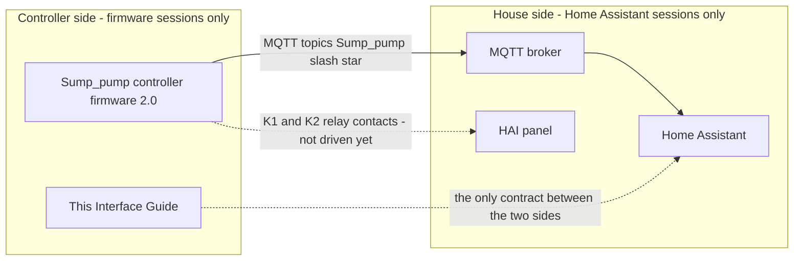
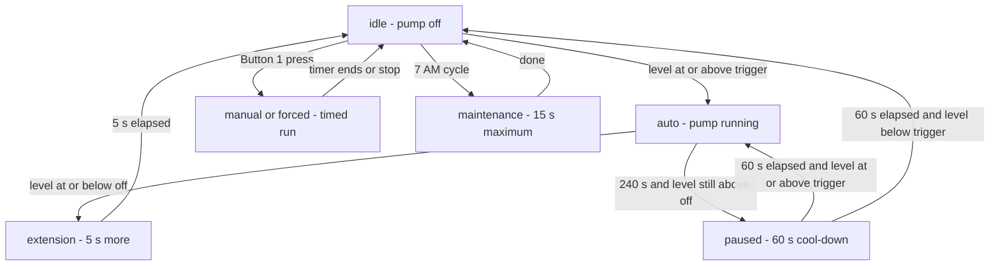
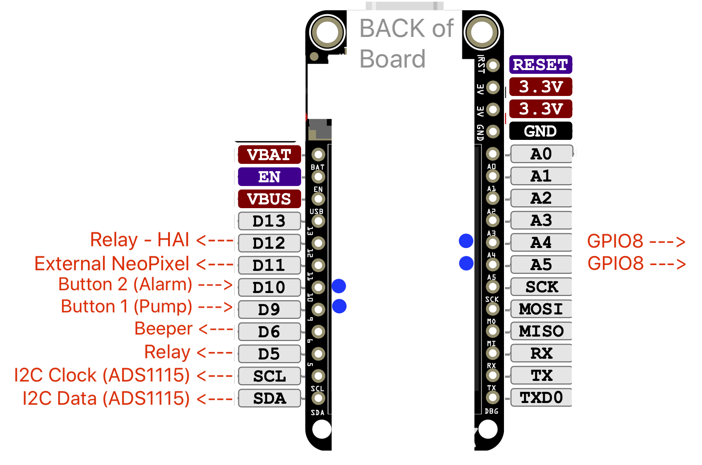
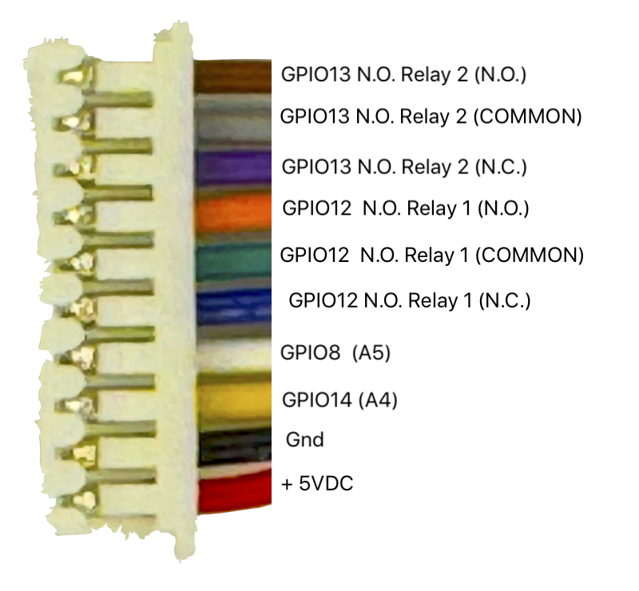
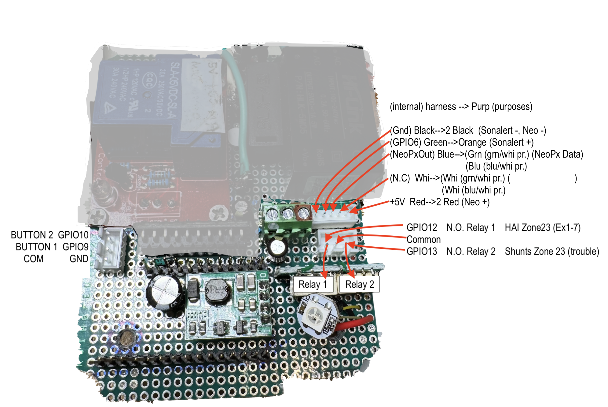
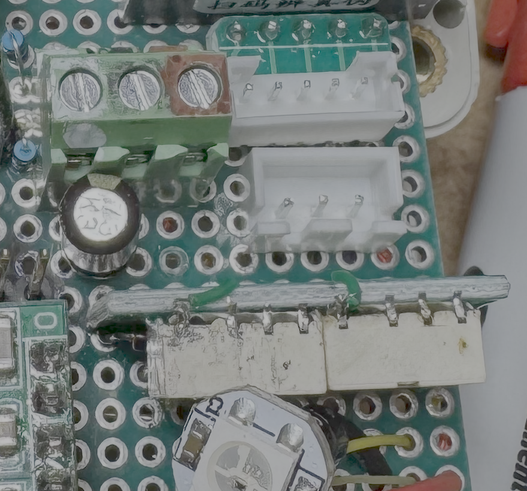
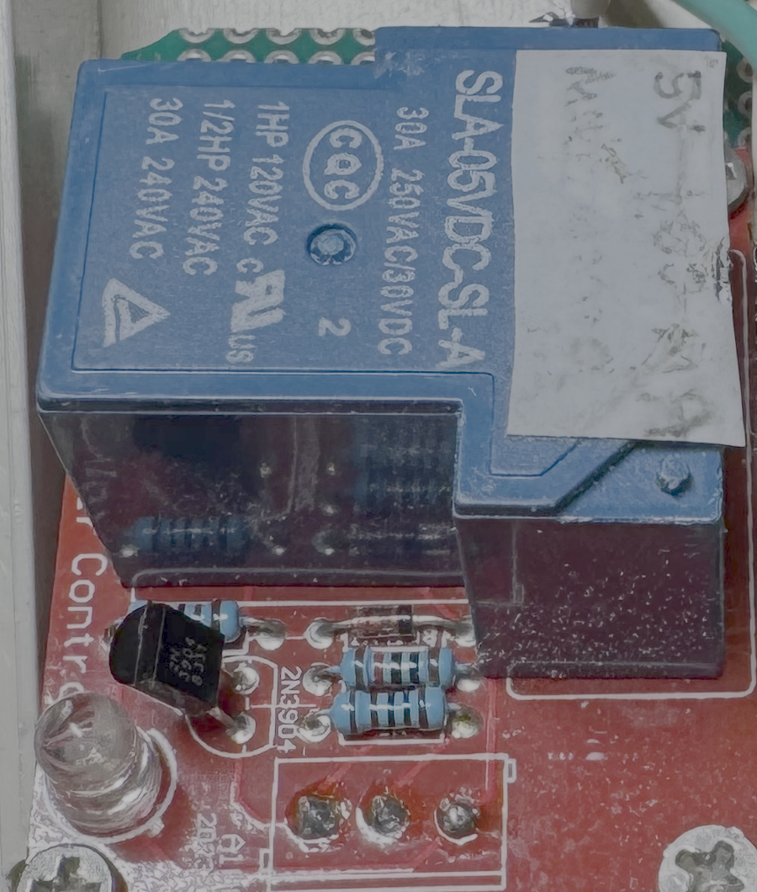

# Sump_pump Controller - Interface Guide (v2.0)

**For:** the Home Assistant / HAI-panel integration session. This document, together with its figures in
`Sump_pump_Interface_Guide_images/`, is **everything** that session is given about the controller. It is written so nothing else is needed.

| | |
|---|---|
| Applies to | Sump controller firmware **2.0** (`FW_VERSION "2.0"`, shown on the controller's screen as `ver 2.0`) |
| Written | 2026-11-25 |
| Written by | A controller (firmware) session of the `SumpMonitorController` project |
| **Verification status** | Firmware 2.0 compiles and its pure logic and JSON output are unit-tested on a PC. **It had NOT been run on the real controller, against the broker, or in Home Assistant when this was written.** Everything below is taken from the firmware source and the project's wiring pictures. Items that only a bench or on-site check can settle are tagged **UNVERIFIED**. |
| Interface version | `2.0`. The topic names, JSON field names, command words and entity ids below are the contract. New fields may be **added** in later versions; existing ones will not be renamed or removed without a new major interface version and an updated guide. Ignore unknown JSON fields. |

---

## 0. The wall of separation (read first)



**The two sides are deliberately separate. The user set this rule; it is not optional.**

**Controller sessions** (Claude sessions started in the `SumpMonitorController` project):
- are the **only** sessions that may read, change, build, upload (OTA/USB) or reflash the controller firmware, edit its sketch, or change its hardware documents;
- own this guide and keep it correct;
- **never** touch Home Assistant, the HAI panel, OmniLinkBridge, the MQTT broker's configuration, or any Home Assistant project's files, entities, dashboards or automations. They do not log in to those systems and do not call their APIs. If they need a fact about the house side they ask the user.

**Home Assistant sessions** (Claude sessions started in the Home Assistant project):
- rely on **this guide alone** for everything about the controller; talk to the controller **only** through the MQTT interface in sections 3-7 (and, if the user decides so, the hardware contacts in sections 8-9);
- **never** read, edit, build, upload or flash the controller's firmware or sketch, never use or ask for its OTA/WiFi/MQTT credentials (they are deliberately not in this guide), and never edit the controller's hardware documents;
- **must not send commands that move the pump or change its settings** (`pump_on`, `pump_off`, `disable`, `enable`, `set`) while testing unless the user explicitly says so for that test. `stats`, `help` and `silence` are harmless. Never publish a command with the MQTT **retain** flag;
- treat an observed behavior that disagrees with this guide as a **discrepancy to report to the user**, who will take it to a controller session. Do not work around it in a way that depends on undocumented behavior.

**Requesting a change to the controller** (new behavior, new field, driving K1/K2, different thresholds, anything in firmware): the Home Assistant session writes a short request to the user, and the user brings it to a controller session. A useful request states: what is needed, why, what the Home Assistant side will do with it, and any timing or polarity facts it knows (see section 9.5 for the questions the controller side needs answered for the HAI relay outputs). The controller session then changes the firmware, re-tests, and issues a new version of this guide; the Home Assistant session should use the newest guide only.

---

## 1. At a glance

| Item | Value |
|---|---|
| What it is | An automatic sump-pump controller: ESP32-S2 (Adafruit Feather ESP32-S2 TFT), ADS1115 ADC, 0-10 V water-level sensor, pump relay, two spare relays (K1/K2) toward the HAI panel, beeper, status LEDs, 240x135 display, two buttons |
| MQTT topic prefix | **`Sump_pump`** (exact case; MQTT topics are case-sensitive) |
| Broker the firmware connects to | `192.168.1.12`, port `1883`, anonymous, no TLS (built-in default; changeable only by a controller session) |
| MQTT client id | `Sump_pump` (fixed). **No other MQTT client may use this id**, or the controller is disconnected |
| Availability | `Sump_pump/status` = `online` / `offline`, retained; `offline` is the MQTT last will |
| Telemetry | `Sump_pump/state` (JSON, not retained): every 5 min normally, every 2 min while water is rising or a problem exists, and immediately on any change |
| Problems | `Sump_pump/event` (JSON) pushed the moment a problem is raised or cleared, and also reflected in `state` |
| Commands in | `Sump_pump/cmd`, plain text: `stats`, `pump_off`, `pump_on [sec]`, `disable [hours]`, `enable`, `silence`, `set trigger=.. off=.. alarm=..`, `help` |
| Replies | `Sump_pump/response` (JSON, one per command); `stats` also sends a full dump on `Sump_pump/stats` |
| Home Assistant discovery | The controller publishes retained MQTT-discovery configs for **28 entities** under one device, **"Sump Pump"**, prefix `homeassistant` |
| Hardware outputs for the HAI panel | K1 (GPIO12) and K2 (GPIO13) relays exist and are wired (see figures) but **firmware 2.0 never energizes them** (section 8-9) |
| Units | inches for levels, seconds for durations, dBm for WiFi, local time for display strings, UTC for `last_run_utc` |

---

## 2. What the controller does (behavior specification)

### 2.1 Measuring the level

- A 0-10 V submersible sensor (QDY30A, 1 m range) goes through a 20 kΩ / 10 kΩ divider to the ADS1115 (I2C address `0x48`, gain +/-4.096 V). Level in inches = sensor volts / 10 x 39.37, plus the sketch's sensor offset (currently `0.0` in; reported as `sensor_offset_in` in the stats dump), clamped to **0.0 - 18.0 in**.
- A reading is taken **every 2 seconds** as the **median of 5** conversions, which rejects spikes from relay/pump switching.
- If the ADC stops answering, the last good level is kept. After **5 failed reads in a row (about 10 s)** the controller declares **sensor fault** (`sensor_fault: true`, `level_in: null`, alarm). The fault clears after **3 good reads in a row (about 6 s)**. While faulted, **automatic pump START is blocked** (a pump already running still ends at its 240 s timeout; manual/forced runs still work).
- A sensor wire that is unplugged or broken reads as **0.0 in, exactly like an empty sump** (0-10 V sensor with a divider to ground, no live-zero). The controller **cannot detect that** failure.

### 2.2 Automatic pumping

Thresholds are runtime settings (defaults in the table; change with the `set` command; stored in flash).

| Setting | Default | Meaning |
|---|---|---|
| `trigger_in` | 5.0 in | Automatic pump **starts** at or above this level |
| `off_in` | 1.0 in | When the pump is running and the level is at or below this, the **stop extension** begins |
| `alarm_in` | 10.0 in | **High-water alarm** above this; clears at `alarm_in - 0.5` |
| extension | 5 s | Pump keeps running this long after reaching `off_in`, then stops |
| run timeout | 240 s | A run that lasts 240 s with the level still above `off_in` is stopped |
| cool-down | 60 s | After a timeout the pump may not restart for 60 s (`pump_state` = `paused`) |
| restart rule | level >= `trigger_in` | After the cool-down it restarts only when the level is again at or above the trigger |
| trouble | 3 | Three timeouts in a row with the water still high latch **pump trouble** |



Latency: the level is sampled every 2 s and the control loop runs every 0.1 s, so the pump relay reacts **within about 2.1 s** of the water crossing a threshold.

`pump_trouble` clears when the level reaches `off_in` or a normal run (one that reaches `off_in`) completes. The pump keeps cycling 240 s on / 60 s off while trouble is latched.

### 2.3 Manual, forced and maintenance runs

- **Button 1 (on the unit):** first short press runs the pump 20 s; each further press within the first 10 s adds 20 s (up to 8 presses = 160 s); a press after that window, or a 4 s long press, stops it. Automatic control stands aside while a manual run is active.
- **Forced run (MQTT `pump_on`):** 5-300 s (default 300 s). Reuses the manual timer. It does **not** stop when the level is low (it can run the pump dry for the whole time). Button 1 or `pump_off` stops it early.
- **7 AM maintenance cycle:** once a day, at any time within the **7:00-7:59 local** hour (once the clock is synced), if the level is at least **0.5 in**, the pump runs until the level is at or below **0.25 in** plus 3 s, **15 s maximum**. It is **not** counted in the run statistics (`today_s` etc.). It is skipped if the pump is already running, cooling down, in manual/forced mode, disabled, or an update is in progress. The decision is made once per day (not remembered across a reset).

### 2.4 Pump disable (remote)

`disable [hours]` stops the pump and keeps **automatic pumping and the 7 AM cycle off** for 1-24 h (default 24). It ends on: the timer; the `enable` command; **the high-water alarm becoming active** (a disabled pump re-enables itself so a flooding sump is not left unpumped; firmware switch `DISABLE_CANCELS_AT_ALARM`, currently on); or **any controller reset or power cycle** (not remembered, on purpose, so a reset fails safe toward pumping). While disabled: the screen shows `PUMP DISABLED` (the measured level keeps updating), the `pump_disabled` flag is true and `disabled_min` counts down, a forced `pump_on` is refused, and Button 1 on the unit still works (someone standing at it is deliberate).

### 2.5 Alarms

Three independent causes; `alarm` is true if any is present.

| Cause (state field) | Raised when | Cleared when |
|---|---|---|
| `high_water` | level > `alarm_in` | level <= `alarm_in - 0.5` |
| `pump_trouble` | 3 consecutive 240 s timeouts with the level still above `off_in` | level <= `off_in`, or a normal run completes |
| `sensor_fault` | 5 failed sensor reads in a row (about 10 s) | 3 good reads in a row |

An active alarm: red LEDs flashing at 1 Hz, beeper pattern (500 ms on / 1500 ms off), status line on the display (`HIGH WATER!`, `SENSOR FAULT` or `PUMP TROUBLE`). The beeper can be **muted** (`muted: true`) by Button 2 on the unit or the `silence` command; the alarm itself stays active. A mute ends after **30 minutes** if the condition persists, or immediately when a **new** cause appears; it re-arms when all causes clear. Every raise/clear is pushed at once on `Sump_pump/event` and in `state`.

### 2.6 Statistics and time

- Run time is counted in seconds for every automatic, manual and forced run (maintenance excluded) and saved to flash at every pump stop, hourly, and at rollover, so it survives resets. `today_s` is today's total, `five_day_s` is today plus the previous four days, `daily_s` (stats dump only) lists today ... 4 days ago.
- **Day rollover at local midnight**, once the clock is synced (a controller that was off for days shifts the history by that many days).
- `last_run_s` / `last_run_utc` are the duration and start time of the last counted run.
- Time source: NTP (`pool.ntp.org`), timezone **US Pacific with automatic daylight saving** (`PST8PDT,M3.2.0,M11.1.0`). `time` strings are local; `last_run_utc` is UTC. Until the clock is first synced the controller reports `"unsynced"` where it would give a time, and **no rollover or 7 AM cycle can happen**.

### 2.7 Boot, reset and power behavior

- The pump relay output is set **OFF as the very first instruction** of start-up. A normal start takes about 8-11 s (display boot log, WiFi wait of up to 5 s that does not block pump control); pump control is live from the end of that sequence.
- A reset (watchdog, brownout, crash, button-hold reboot) drops all relays; the reason is reported in `reset` (`power-on`, `software`, `CRASH (panic)`, `WATCHDOG (int)`, `WATCHDOG (task)`, `WATCHDOG`, `BROWNOUT`, `reset pin`, `other`) and shown on the boot screen.
- A watchdog resets the controller if its main loop stalls for more than 5 s (for example if the ADC hangs the bus).
- During an over-the-air firmware update the pump is turned **off** and automatic control is suspended until the update ends; queued commands are discarded.

---

## 3. MQTT connection and session behavior

| Parameter | Value |
|---|---|
| Protocol | MQTT 3.1.1 (PubSubClient 2.8). Home Assistant's own connection may use any version the broker supports |
| Broker | `192.168.1.12:1883` default (IP, not a `.local` name) |
| Authentication | none by default; the firmware supports username/password if a controller session enables it |
| Client id | `Sump_pump` (fixed) |
| Clean session | yes |
| Keep-alive | 30 s (the broker declares the controller gone after about 45 s of silence and then publishes the last will) |
| Socket timeout | 3 s |
| Packet buffer | 2048 bytes (largest message the controller sends: the stats dump, about 1.4 KB) |
| QoS | all controller publishes are **QoS 0**; subscribes are QoS 0; the last will is QoS 1, retained |
| Last will | topic `Sump_pump/status`, payload `offline`, retained |
| On every connect | publishes `online` (retained); subscribes to `Sump_pump/cmd` and `homeassistant/status`; publishes the 28 discovery configs (retained) the first time and at most once a minute after that; then an immediate `state` |
| Heartbeat | re-publishes `online` (retained) every **60 s** while connected, so a ghost session's late last will cannot blank the entities for long |
| Reconnect | at least 5 s between attempts, doubling to 60 s on repeated failure; unlimited retries |
| Home Assistant birth | the controller subscribes to `homeassistant/status`; when it sees `online` it re-publishes discovery and a fresh `state` (state is not retained) |
| Commands after connect | commands are **ignored for the first 1.5 s** after the controller subscribes (retained leftovers are discarded), then it publishes an **empty retained message on `Sump_pump/cmd`** once to wipe any retained command from the broker |
| Retained topics the controller owns | `Sump_pump/status`, the 28 discovery topics under `homeassistant/<type>/sump_pump/<id>/config` |
| Topics that are never retained | `state`, `stats`, `event`, `response` |

---

## 4. Topics and payloads

All JSON is UTF-8, booleans are JSON `true`/`false`, `null` means "not available". All numbers are plain JSON numbers.

### 4.1 `Sump_pump/status` (retained)

`online` or `offline` (plain text). Use this as the availability topic.

### 4.2 `Sump_pump/state` (not retained)

Published on any change, every 5 min normally (every 2 min in elevated mode), and after every (re)connect and Home Assistant restart. At most one message per 2 s. About 500 bytes.

| Field | Type | Meaning |
|---|---|---|
| `time` | string | Controller local time `YYYY-MM-DD HH:MM:SS PST/PDT`, or `"unsynced"` |
| `level_in` | number or null | Water level, inches (2 decimals); **null while the sensor is faulted** |
| `pump` | string | `"ON"` when the pump relay is energized, else `"OFF"` |
| `pump_state` | string | `idle`, `auto`, `extension`, `manual`, `maintenance`, `paused`, `ota`. A forced run reports `manual` with `forced: true`. A disabled pump reports `idle` with `pump_disabled: true` |
| `high_water` | bool | high-water alarm cause active |
| `pump_trouble` | bool | pump-trouble cause active |
| `sensor_fault` | bool | level-sensor-fault cause active |
| `alarm` | bool | any of the three causes active |
| `muted` | bool | alarm beeper muted |
| `pump_disabled` | bool | pump disabled by command |
| `disabled_min` | integer | whole minutes of disable remaining (0 when not disabled) |
| `forced` | bool | a forced (`pump_on`) run is in progress |
| `report_mode` | string | `baseline` or `elevated` (section 6) |
| `today_s` | integer | pump run seconds today (maintenance excluded) |
| `five_day_s` | integer | run seconds, today plus previous 4 days |
| `last_run_s` | integer | duration of the last counted run, seconds |
| `last_run_utc` | string or null | start of the last counted run, `YYYY-MM-DDTHH:MM:SSZ`; null until a run has been recorded |
| `rssi` | integer | WiFi signal in dBm (0 if WiFi is down) |
| `uptime_s` | integer | seconds since the last reset |
| `fw` | string | firmware version, `"2.0"` |
| `ip` | string | controller IPv4 address |
| `reset` | string | reason for the last reset (section 2.7) |
| `trigger_in`, `off_in`, `alarm_in` | number | current thresholds, inches |

### 4.3 `Sump_pump/stats` (not retained; only in answer to the `stats` command)

The full dump. Subscribe **before** sending the command: it is not retained. About 1.4 KB. Arrives just before the matching `response`.

| Group | Fields (all in one flat object; `daily_s` is an array of 5) |
|---|---|
| identity | `kind` (`"stats"`), `fw`, `build` (compile date/time), `mac`, `ip` |
| time | `time` (local string), `epoch` (Unix seconds, 0 if unsynced), `tz` (POSIX timezone string), `time_synced`, `uptime_s`, `reset` |
| system | `free_heap`, `min_free_heap` (bytes), `wifi_rssi` (dBm), `mqtt_reconnects`, `mqtt_pub_fail`, `cmd_dropped` (commands ignored: retained leftovers, queue full, oversized), `mqtt_task_stack_free` (bytes of MQTT-task stack never used) |
| measurement | `level_in` (null if faulted), `adc_raw` (signed 16-bit counts of the last good median, 0.125 mV per count at the ADC input), `sensor_volts` (sensor-side volts, 0-10), `sensor_ok`, `adc_present` |
| pump | `pump` (`ON`/`OFF`), `pump_state`, `pump_run_s` (seconds the current run has lasted), `manual`, `forced`, `forced_left_s`, `extension`, `maintenance`, `paused`, `pause_left_s`, `pump_disabled`, `disabled_min`, `consecutive_timeouts` |
| alarms | `high_water`, `pump_trouble`, `sensor_fault`, `alarm`, `muted` |
| parameters | `trigger_in`, `off_in`, `alarm_in`, `alarm_clear_in`, `extension_s` (5), `timeout_s` (240), `pause_s` (60), `sensor_offset_in`, `maint_hour` (7), `maint_trigger_in` (0.5), `maint_target_in` (0.25), `maint_max_s` (15), `force_max_s` (300), `disable_max_h` (24) |
| statistics | `today_s`, `five_day_s`, `daily_s` [today, -1 d, -2 d, -3 d, -4 d], `last_run_s`, `last_run_utc` |
| reporting | `report_mode`, `report_baseline_s` (300), `report_elevated_s` (120), `elevated_max_h` (6), `elevated_age_s` (how long elevated mode has lasted) |

### 4.4 `Sump_pump/event` (not retained)

```json
{"event":"high_water","state":"raised","detail":"water level above the alarm threshold","level_in":10.21,"time":"2026-11-25 18:03:52 PST"}
```

| `event` | `state` | When | `detail` text |
|---|---|---|---|
| `high_water` | `raised` / `cleared` | high-water alarm starts / ends | `water level above the alarm threshold` |
| `pump_trouble` | `raised` / `cleared` | pump-trouble latches / clears | `repeated pump timeouts with water still high` |
| `sensor_fault` | `raised` / `cleared` | sensor fault starts / ends | `level sensor not responding` |
| `pump_enabled` | `info` | a pump disable ended on its own | `disable period ended`, or `disable cancelled by the high water alarm` |

Each event is followed within about 2 s by a fresh `state`. Events are QoS 0 and are **not retained**; if one is missed (broker or WiFi down at that moment) the next `state` still shows the true condition, so a Home Assistant integration should drive alerts from the **state flags** and use events as a fast-path hint.

### 4.5 `Sump_pump/response` (not retained)

One message per command that produced a response (an empty command line produces none):

```json
{"cmd":"set","ok":true,"msg":"levels updated and saved to flash","trigger_in":5.50,"off_in":1.00,"alarm_in":10.00,"time":"2026-11-25 18:03:52 PST"}
```

`cmd` is the command word (`stats`, `pump_off`, `pump_on`, `disable`, `enable`, `set`, `silence`, `help`, or `unknown`); `ok` says whether it was carried out; `msg` is the human-readable result (exact strings in section 5); `set` also echoes the three thresholds. There is **no command id**: match a response to its command by `cmd` and by order (commands are executed one at a time in arrival order).

### 4.6 `Sump_pump/cmd` (controller subscribes)

Plain text, one command per message, at most 95 characters, case-insensitive, words separated by spaces or commas. **Never publish with the retain flag.** The controller queues at most 4 commands; bursts faster than about 10 per second can be dropped (counted in `cmd_dropped`).

---

## 5. Commands

| Command | Effect | `ok:false` / refusal messages |
|---|---|---|
| `stats` | Publishes the full dump to `Sump_pump/stats`. Response msg: `statistics published to Sump_pump/stats` | - |
| `help` | Response msg lists the commands | - |
| `pump_off` (or `stop`) | If anything is running (automatic, manual, forced, maintenance): stops it, saves the run to the statistics (unless maintenance), and **holds automatic restart for 60 s** (screen `STOPPED (60s)`, `pump_state` = `paused`). Msg: `pump stopped; automatic restart held for 60 s`. If nothing is running: `ok:true`, msg `pump was not running` | - |
| `pump_on [seconds]` | Forced run for 5-300 s (default 300). Automatic control stands aside; Button 1 or `pump_off` stops it early. **Does not stop at a low level.** If the pump is already running, the whole continuous run is held to 300 s from when it started. Msg: `pump forced ON for N s (Button 1 or pump_off stops it)` (N = the time actually granted) | `refused: pump is disabled (send enable first)`; `refused: 7 AM maintenance cycle running (15 s max), retry shortly`; `refused: a forced run is already active`; `refused: the pump has already been running for almost 5 minutes`; `pump_on: seconds must be a whole number`; `pump_on: seconds must be 5 to 300` |
| `disable [hours]` | Stops the pump now and disables automatic pumping and the 7 AM cycle for 1-24 h (default 24). Msg: `pump DISABLED for N h (send enable to cancel; a reset also clears it)`. Also ends on the high-water alarm (section 2.4) | `disable: hours must be a whole number`; `disable: hours must be 1 to 24` |
| `enable` | Cancels a disable. Msg: `pump enabled; automatic control resumes` (`pump was not disabled` if it was not) | - |
| `silence` | Mutes the alarm beeper. Msg: `alarm beeper silenced (re-sounds after 30 min or on a new problem)` (`no alarm active` if none) | - |
| `set trigger=N off=N alarm=N` | Changes any subset of the thresholds (inches, decimals allowed). Missing values keep their current setting; the **final combination** is validated; values that differ are written to flash. Msg: `levels updated and saved to flash` or `no change (flash not written)`; the response echoes `trigger_in`, `off_in`, `alarm_in` | validation: `off must be 0.5 to 6.0 in`; `trigger must be 2.0 to 12.0 in`; `trigger must be at least off + 1.0 in`; `alarm must be at least trigger + 1.0 in`; `alarm must be 17.0 in or less`. Parsing: `set: give trigger=, off= and/or alarm=`; `set: use key=value (trigger, off, alarm)`; `set: value is not a number`; `set: unknown key (use trigger, off, alarm)`. Flash-wear guard: `refused: wait 10 s between level changes (flash wear)` (a level change that writes flash is allowed at most once every 10 s; repeating the current values is free) |
| anything else | `ok:false`, `cmd:"unknown"`, msg `unknown command (send: help)` | - |

Notes for integrators:
- **Accepted aliases** (same effect as the main word): `dump` = `stats`; `stop` = `pump_off`; `force_on` = `pump_on`; `pump_disable` = `disable`; `pump_enable` = `enable`; `set_levels` = `set`; `mute` = `silence`. Use the main words in new work; the response `cmd` field always shows the main word.
- **Bare `ON` / `OFF` are rejected on purpose** (`unknown command`), so a Home Assistant MQTT *switch* with its default payloads can never run or stop the pump by accident. Use buttons with payloads such as `pump_off`, or explicit switch payloads.
- `set` examples: `set trigger=5.5`, `set trigger=6 off=1.5 alarm=11`, `SET Off=0.8`.
- A Home Assistant `number` entity sends `set trigger={{ value }}` (see section 7); the controller answers with a `response` and a fresh `state`.
- Commands are executed by the controller's main loop, **at most about 0.1 s after they are received**; the response follows within a second or two.

---

## 6. Reporting behavior

| Mode | Cadence |
|---|---|
| **baseline** | one `state` every **5 minutes** |
| **elevated** | one `state` every **2 minutes** |
| any change | an immediate `state` (rate-limited to one per 2 s): pump on/off, extension, pause, forced, disabled/enabled, alarm cause raised/cleared, mute, reporting-mode switch, every command response, after every (re)connect and Home Assistant restart |

**Entering elevated mode:** the level has risen **0.5 in or more** above its lowest value in the last 10 minutes (sampled every 30 s), **or** any alarm cause exists. A normal slow fill (about 0.01 in/min) does not trigger it; a wet-weather rise does. A pump that is disabled while the level rises also triggers it (rise rule). The first elevated report is sent immediately.

**Leaving elevated mode (back to normal):** pump idle, no alarm, level at or below `max(2.0 in, off_in + 0.5)`, and not rising, **continuously for 5 minutes**. One report is sent when it ends.

**Forced end:** elevated mode ends by itself after **6 hours** even if the condition persists (one last report is sent). It **cannot restart** until a full 5-minute calm period has been seen; otherwise a condition that never clears would re-enter immediately and the 6 h limit would mean nothing.

Freshness guidance for the Home Assistant side: with baseline reporting the longest gap between `state` messages is 5 minutes; the controller's own discovery sets `expire_after` to **900 s** (3 missed baseline reports). If `Sump_pump/status` is `online` but `state` is older than 15 minutes something is wrong with the controller's loop or publishing, not just with WiFi.

---

## 7. Home Assistant discovery (what the controller publishes)

The controller publishes **retained** MQTT-discovery configs to `homeassistant/<type>/sump_pump/<id>/config`, all attached to **one device**:

```json
{"name":"Water level","unique_id":"sump_pump_water_level","state_topic":"Sump_pump/state",
 "value_template":"{{ value_json.level_in }}","unit_of_measurement":"in","device_class":"distance",
 "state_class":"measurement","expire_after":900,"availability_topic":"Sump_pump/status",
 "device":{"identifiers":["sump_pump"],"name":"Sump Pump","manufacturer":"DIY",
           "model":"Feather ESP32-S2 TFT + ADS1115","sw_version":"2.0"}}
```

Home Assistant derives entity ids from the device name and entity name, so entity ids are expected to look like `sensor.sump_pump_water_level` (**UNVERIFIED** until the device has actually appeared; confirm in Home Assistant). All entities use `availability_topic: Sump_pump/status`. Sensors and binary sensors also set `expire_after: 900`.

| Type | `<id>` (unique_id = `sump_pump_<id>`) | Name | Source |
|---|---|---|---|
| sensor | `water_level` | Water level (in, distance, measurement) | `level_in` |
| sensor | `pump_state` | Pump state | `pump_state` |
| sensor | `runtime_today` | Runtime today (s, duration) | `today_s` |
| sensor | `runtime_5day` | Runtime 5 days (s) | `five_day_s` |
| sensor | `last_run_duration` | Last run duration (s) | `last_run_s` |
| sensor | `last_run_time` | Last run time (timestamp) | `last_run_utc` |
| sensor | `disabled_remaining` | Pump disable remaining (min) | `disabled_min` |
| sensor | `report_mode` | Reporting mode (diagnostic) | `report_mode` |
| sensor | `wifi_signal` | WiFi signal (dBm, diagnostic) | `rssi` |
| sensor | `uptime` | Uptime (s, diagnostic) | `uptime_s` |
| sensor | `reset_reason` | Last reset reason (diagnostic) | `reset` |
| sensor | `firmware` | Firmware (diagnostic) | `fw` |
| sensor | `ip_address` | IP address (diagnostic) | `ip` |
| binary_sensor | `pump_running` | Pump running (class running) | `pump` (`ON`/`OFF`) |
| binary_sensor | `high_water` | High water (class problem) | `high_water` |
| binary_sensor | `pump_trouble` | Pump trouble (class problem) | `pump_trouble` |
| binary_sensor | `sensor_fault` | Level sensor fault (class problem) | `sensor_fault` |
| binary_sensor | `alarm` | Alarm (class problem) | `alarm` |
| binary_sensor | `pump_disabled` | Pump disabled | `pump_disabled` |
| button | `stats_dump` | Stats dump | publishes `stats` |
| button | `pump_stop` | Stop pump | publishes `pump_off` |
| button | `pump_force_on` | Run pump 5 min | publishes `pump_on` |
| button | `pump_disable_24h` | Disable pump 24 h | publishes `disable` |
| button | `pump_enable` | Enable pump | publishes `enable` |
| button | `silence_alarm` | Silence alarm | publishes `silence` |
| number | `trigger_level` | Trigger level (2.0-12.0 in, step 0.1) | `trigger_in`; sends `set trigger={{ value }}` |
| number | `off_level` | Off level (0.5-6.0 in, step 0.05) | `off_in`; sends `set off={{ value }}` |
| number | `alarm_level` | Alarm level (2.0-17.0 in, step 0.1) | `alarm_in`; sends `set alarm={{ value }}` |

**The buttons and numbers are real controls.** "Run pump 5 min" runs the pump, dry if the sump is empty. Keep them off family-facing dashboards (or disable those entities in Home Assistant's entity settings). The number entities' UI minimum/maximum are only a hint: the controller enforces its own limits (section 5) and answers `ok:false` with a reason.

Points the controller side could **not** verify offline (check them in Home Assistant and report what you see):
- how `null` values render through the templates (`level_in` is null during a sensor fault; `last_run_utc` is null until the first run) - Home Assistant may show "unknown" or log a template error;
- whether the icons used (`mdi:water-pump`, `mdi:water-pump-off`, `mdi:timer-outline`, `mdi:clipboard-text-outline`, `mdi:stop`, `mdi:play`, `mdi:bell-off`) exist in the installed icon set (cosmetic);
- `state` is not retained, so after a Home Assistant restart the entities may read "unknown" until the controller answers the `homeassistant/status` birth message (it re-publishes discovery and state at once) or the next report.

---

## 8. Physical I/O

### 8.1 Figures

**Figure 1 - Feather pin map, back view, with the project's annotations** (cropped from `SumpControllerESP32-hookup_Reverse.png`). The red labels say which header pin does what. **Two label mistakes in the original picture:** both A4 and A5 are labeled "GPIO8" (correct: **A4 = GPIO14, A5 = GPIO8**, as Figure 2 and the firmware show); and the "Relay - HAI" label sits on D12 while D13 (Relay 2) is unlabeled. The blue dots beside D9, D10, A4 and A5 have **no legend in the picture**; this guide does not interpret them.



**Figure 2 - the 10-wire harness connector** (cropped from the same picture). Wire colors and signals exactly as labeled there: Relay 2 N.O. (brown), Relay 2 COMMON (grey), Relay 2 N.C. (purple), Relay 1 N.O. (orange), Relay 1 COMMON (green), Relay 1 N.C. (blue), GPIO8 / A5 (white), GPIO14 / A4 (yellow), Gnd (black), +5 VDC (red). The label text "N.O. Relay" names the relay module, and each relay brings out all three contacts (normally open, common, normally closed).



**Figure 3 - annotated photo of the board** (cropped from `SumpPumpControllerConnections_Details_Sm.png`). The labels beside the 3-pin connector read: **"GPIO12 N.O. Relay 1 - HAI Zone23 (Ex1-7)"**, **"Common"**, **"GPIO13 N.O. Relay 2 - Shunts Zone 23 (trouble)"**. The 5-pin connector above it is the internal harness for the beeper ("Sonalert") and the external NeoPixel: Gnd (black), GPIO6 (green, Sonalert +), NeoPx data (blue), N.C. (white), +5V (red). The 4-pin connector on the left carries Button 2 (GPIO10), Button 1 (GPIO9), COM and GND. (A typo, "Purp (purposes)", is in the original.)



**Figure 4 - photo close-up of the same area** (cropped from `SumpPumpControllerConnections.png`): the green 3-screw terminal block, the 5-pin internal-harness connector, the 3-pin relay-contact connector, and the two small relays (Relay 1 and Relay 2) soldered to a header strip, with the external NeoPixel below. Part markings on the small relays are not legible in the photo, so **their contact ratings are not recorded** (treat them as low-current signal relays until measured). The purpose of the green 3-screw block is not labeled in any project picture.



**Figure 5 - photo of the pump relay and its driver** (cropped from `SumpPumpControllerConnections.png`): relay **SLA-05VDC-SL-A** (5 V coil; markings read 30 A 250 VAC / 30 VDC, 1 HP 120 VAC, 1/2 HP 240 VAC), with a transistor (marking 2N3904), resistors and a diode on the red driver board. The schematic of that driver (base resistor, pull-down) is **not documented**. The 5 V supply seen in the full photo is a Hi-Link HLK-5M05 (100-240 VAC in, 5 V 1 A out).



Other pictures in the project's `docs/` folder were **not** used: `Pump_Controller_Indications.png` documents an old firmware's LED behavior (120 s timeout, "alarm = pump timeout") and is wrong for 2.0; the older text files (`Specs.md`, `QuickConnections.txt`, parts of `feather_wiring_diagram.md`) still contain active-low relay and wrong I2C pin statements. **This guide and the firmware are authoritative.**

### 8.2 Pin table (everything the firmware drives or reads)

| Signal | GPIO / Feather pin | Direction | Active level | What is known about the electrical side |
|---|---|---|---|---|
| **Pump relay** | GPIO5 / D5 | output | HIGH = relay energized = pump ON | 3.3 V push-pull output into a transistor driver (2N3904 visible, Fig. 5) and relay SLA-05VDC-SL-A. No pull resistor values documented. |
| **K1 = Relay 1** | GPIO12 / D12 | output | HIGH = relay energized | 3.3 V push-pull. Contacts N.O./COMMON/N.C. on the harness (Fig. 2); the 3-pin connector is labeled "HAI Zone23 (Ex1-7)" (Fig. 3). Driver circuit and pull resistors **not documented**. |
| **K2 = Relay 2** | GPIO13 / D13 | output | HIGH = relay energized | 3.3 V push-pull. Contacts on the harness (Fig. 2); labeled "Shunts Zone 23 (trouble)" (Fig. 3). The Feather's on-board red LED silkscreened "13" is on this pin on Adafruit Feathers, so K2 energized also lights it (Adafruit's board design; **UNVERIFIED** on this unit). Driver circuit and pull resistors **not documented**. |
| **Beeper (Sonalert)** | GPIO6 / D6 | output | HIGH = sounds | Green wire to Sonalert +, black to Sonalert - (Fig. 3). |
| External NeoPixels | GPIO11 / D11 | output | WS2812 data | 2 pixels; 330 ohm series resistor per the project wiring notes; 5 V from the harness. |
| On-board NeoPixel | GPIO33 (power switch GPIO34) | output | WS2812 data | Built into the Feather. |
| **Button 1** (pump) | GPIO9 / D9 | input | LOW = pressed | Firmware sets plain `INPUT` and its source comment says "external 10k pull-up"; the pull-up is not visible in the photos. |
| **Button 2** (alarm) | GPIO10 / D10 | input | LOW = pressed | Same as Button 1. |
| Misc input 1 | GPIO14 / A4 (yellow wire) | input | - | Firmware enables the **internal pull-up** (`INPUT_PULLUP`, about 45 kohm nominal for ESP32-S2). Not used for any control; only shown on the screen as `IO14`. Reserved for a future temperature probe. |
| Misc input 2 | GPIO8 / A5 (white wire) | input | - | Same as above; shown as `IO8`. |
| I2C | GPIO42 SDA, GPIO41 SCL | bus | - | ADS1115 at `0x48`. Pull-ups: the ADS1115 module's 10 kohm plus the Feather's own (powered by GPIO21 held HIGH). Do not add more. |
| TFT power / backlight | GPIO21 / GPIO45 | outputs | HIGH | Held HIGH by firmware. |

Logic level is **3.3 V** everywhere. The firmware never uses PWM or open-drain on these pins.

### 8.3 Outputs - behavior, meaning, timing

**Pump relay (GPIO5).** Energized exactly while `pump` is `"ON"`.

| Event | Relay |
|---|---|
| Boot / reset | OFF within the first instructions of start-up; before that (reset/ROM time) the pin is high-impedance |
| Automatic start | ON within about 2.1 s of the level reaching `trigger_in` (2 s sample period + 0.1 s loop) |
| Automatic stop | OFF `extension_s` (5 s) after the level reaches `off_in`; or immediately at the 240 s timeout when the level is still above `off_in`; the run statistics are written to flash first (about 50 ms) |
| Cool-down | OFF for at least 60 s after a timeout |
| Manual (Button 1) | ON immediately for 20 s per press, 160 s maximum |
| Forced (`pump_on`) | ON immediately for the requested 5-300 s, never beyond 300 s of continuous running |
| Maintenance | ON for at most 15 s (usually a few seconds), once per day in the 7 o'clock hour |
| Disable / `pump_off` | OFF immediately |
| Over-the-air update | OFF immediately, stays off during the update |
| Watchdog / brownout / crash | OFF (pin released), then the controller restarts |

**K1 (GPIO12) and K2 (GPIO13): in firmware 2.0 they are never energized.** Both pins are configured as outputs and driven **LOW** during start-up and are not changed afterwards. The firmware has a `relay1_on`/`relay2_on` status in its display code that is never set, so the screen always reads `K1:OFF K2:OFF`. There is **no MQTT field** for K1/K2 because there is nothing to report. See section 9 for what that means for the HAI panel.

- **Start-up window:** K1/K2 are configured only after about **0.55 s** of start-up work (serial delay and power sequencing), plus the chip's reset/boot time before that, so for roughly **1 second** after power-up or any reset they are high-impedance. Whether a pull-down holds the relays off during that window is **not documented** (**UNVERIFIED**; measure it with a scope or meter before using K1/K2 for anything safety-related).
- **Power loss:** with no power every relay is de-energized and the contacts fall to their de-energized positions (N.O. open, N.C. closed).

**Beeper (GPIO6).**

| Situation | Behavior |
|---|---|
| Power-up | one 200 ms beep when start-up completes |
| Alarm active, not muted | repeating 2 s cycle: **500 ms sounding, 1500 ms silent**, for as long as the alarm is active |
| Alarm active, muted | silent; re-sounds after 30 min if still active, or at once for a new cause |
| No alarm | silent |

**NeoPixels (status LEDs).** Onboard pixel and external pixel 1 mirror the same status, blinking 500 ms on / 500 ms off: **green** level below 6 in, **blue** 6 to below 8 in, **purple** 8 in and above; during an alarm they flash **red at 1 Hz**; yellow during start-up. **External pixel 0** blinks the level as a count (then a 2 s pause), dimmed to 30 % below 1 in:

| Level (in) | Pattern |
|---|---|
| below 1 | status color at 30 %, steady blink |
| 1 - 2 | 1 blink, purple 60 % |
| 2 - 3 | 2 blinks, purple 80 % |
| 3 - 4 | 3 blinks, purple 80 % |
| 4 - 5 | 4 blinks, yellow 80 % |
| 5 - 6 | 5 blinks, yellow 100 % |
| 6 - 7 | 6 blinks, orange 70 % |
| 7 and above | 7 blinks, orange 100 %, at 4 Hz |

**Display (local).** Top line: level (`ERR` while the sensor is faulted), clock, firmware version, `MQTT ok`/`MQTT --`. Last run, today / 5-day totals. Status line: `HIGH WATER!`, `SENSOR FAULT`, `PUMP TROUBLE` (red, `(mute)` when muted); else `PUMP ON (Ns)` (yellow); else `PUMP DISABLED` (magenta); else `STOPPED (Ns)` / `COOLING (Ns)` (orange); else `WATCHING` (green). Forced runs show a red `FORCED ON (Ns)` countdown. A one-line response to each remote command is shown for 6 s.

### 8.4 Inputs - behavior

- **Button 1:** see section 2.3. **Button 2:** short press mutes the alarm beeper. **10 presses within 30 s resets all run statistics to zero** (there is no MQTT command for this). **Hold both buttons for 5 s:** the controller reboots.
- **GPIO14 / GPIO8:** read and displayed only. They do not affect control and are not reported over MQTT. They are available for future use (for example a DS18B20 temperature probe on GPIO14 with a 4.7 kohm pull-up to 3.3 V).

---

## 9. Interfacing the HAI panel

### 9.1 What the project's pictures establish

- Two relays, **Relay 1 (K1, GPIO12)** and **Relay 2 (K2, GPIO13)**, are built into the controller. Each has a full set of contacts (N.O., COMMON, N.C.) on the 10-wire harness (Fig. 2).
- A 3-pin connector is annotated (Fig. 3): pin 1 **"GPIO12 N.O. Relay 1 - HAI Zone23 (Ex1-7)"**, pin 2 **"Common"**, pin 3 **"GPIO13 N.O. Relay 2 - Shunts Zone 23 (trouble)"**. In words: Relay 1 is connected to **HAI zone 23, expansion enclosure 1, terminal 7**, and Relay 2 is meant to **shunt (short) the same zone to signal "trouble"**.
- The back-of-board pin map labels D12 "Relay - HAI" (Fig. 1).

### 9.2 What the firmware does today

Nothing. **K1 and K2 are never energized by firmware 2.0** (section 8.3). Whatever the HAI panel currently reads on zone 23 is simply the **de-energized contact state** of the relays, permanently. The panel therefore **cannot** learn about high water, pump trouble, sensor faults or a dead controller through the relay wiring today.

### 9.3 What is NOT known (must be measured before designing on it)

| Unknown | Why it matters | How to settle it |
|---|---|---|
| Exactly how the three connector pins and two relays are wired to zone 23: is the zone loop in series with Relay 1's N.O. contact, with its N.C. contact, or only with the COMMON and an end-of-line resistor? | Decides whether "relay energized" means the zone reads secure or violated | Power the controller down, then measure resistance across the zone-23 terminals and between the connector pins with the relays in each state (a controller session can add a bench-test command if wanted) |
| Zone 23's type and end-of-line resistor in the HAI panel's configuration | Decides which contact states the panel reads as normal / open / short | Read it from the panel's configuration (Home Assistant / HAI side) |
| Whether "trouble" is a short across the zone, as "Shunts Zone 23 (trouble)" suggests | Decides K2's polarity | Same measurement |
| Contact ratings of the two small relays | A supervised zone passes only microamps to milliamps; confirm before anything heavier | Read the part markings (not legible in the photos) |
| Pull-down on the K1/K2 driver inputs | Determines what the contacts do during the ~1 s start-up window | Scope or meter on the relay coils during a reset |
| An older design note (from earlier project papers) said K1 = "1 kohm in the zone when OFF, open circuit on alarm" and K2 = "short on trouble, N.C. so a power failure also reads as trouble"; that note contradicts itself on K2's polarity | Do not rely on it | Superseded by the measurements above |

### 9.4 Options for getting sump status to the HAI panel

| Option | How | Survives WiFi / broker / Home Assistant down? | Needs a firmware change? | Status |
|---|---|---|---|---|
| **A. Hardwired zone via K1 (and K2)** | Controller energizes/de-energizes K1/K2 according to defined conditions; the HAI zone reads the contacts | **Yes** - works with the network, broker and Home Assistant all down | **Yes** - firmware does not drive K1/K2 yet (section 9.5 gives the proposal) | Hardware present, behavior **not implemented** |
| **B. MQTT -> Home Assistant -> HAI** | The Home Assistant side reads `high_water`, `alarm`, `pump_trouble`, `sensor_fault` (and availability) and relays them to the panel by whatever means it has (for example a flag, unit or button on the panel) | **No** - needs WiFi, broker, Home Assistant and the bridge to the panel | **No** - available today | The contract in sections 3-7 |
| **C. Both** | B for rich information and alerts, A as the independent fail-safe | A survives the failures B does not | Yes (for A) | Recommended end state |
| D. Use the spare inputs | GPIO14 / GPIO8 are **inputs**, not outputs; they cannot signal the panel | - | - | Not applicable |

### 9.5 Proposed K1/K2 behavior (PROPOSAL - NOT IMPLEMENTED - do not build on it until a new guide version says it is)

Written so the user can decide and the Home Assistant/HAI session can say what it needs. The polarity choice is purely a wiring/firmware decision because both N.O. and N.C. contacts are available on the harness.

- **Fail-safe principle:** power loss, a crash, a watchdog reset and the ~1 s boot window all leave the relays **de-energized**. If "de-energized" should read as a problem at the panel, the firmware must keep the relays **energized while healthy** and de-energize them for a problem. If "de-energized" should read as normal, the relays are energized only for a problem and a dead controller is not seen by the panel at all.
- **K1 - sump status (candidate):** reflects `high_water` OR `pump_trouble` OR `sensor_fault`, i.e. the `alarm` flag, optionally held for a minimum time (for example 10 minutes of continuous high water before asserting) to avoid nuisance zone trips.
- **K2 - controller trouble (candidate):** reflects "the controller is not healthy": sensor fault, repeated watchdog resets, or no power. A natural implementation is **energized while the controller is running normally**, so a crash, reset or power loss drops it within about 5-6 s (5 s watchdog plus reset) and the zone sees trouble. Cost: every reboot shows brief trouble (about 8-11 s until start-up completes).
- **Timing the firmware can offer:** reaction within about 2.1 s of the condition (sample period plus loop), hold times and hysteresis are free choices (suggest: assert immediately, de-assert only after the condition has been absent for a set time, for example 60 s).
- **Not available without a firmware change:** momentary pulses, per-condition relays beyond K1/K2, and any relay output for "pump is running".

**What the controller session needs from the user / Home Assistant side to implement it:**
1. The measured wiring facts in section 9.3 (or permission to add a bench-test command that toggles K1/K2 for 10 s so the panel's reading can be observed).
2. For each of K1 and K2: the conditions that should drive it, the polarity (energized = healthy or energized = problem), minimum assert time, de-assert delay.
3. How the panel should treat the contact states (zone type, end-of-line resistor, what a short and an open should mean).
4. Whether a controller reset or the boot window may show as a brief trouble.

---

## 10. Failure behavior (what to expect)

| Situation | What the controller does | What Home Assistant sees |
|---|---|---|
| WiFi down | Pump control, alarms, beeper, LEDs, display and statistics continue unchanged; WiFi reconnect attempts every 30 s; OTA and MQTT resume by themselves | `Sump_pump/status` goes `offline` within about 45 s (broker last will); entities unavailable; no new `state`/`event` |
| Broker down | Same; the MQTT task retries (5 s doubling to 60 s) without affecting pump control | Entities go unavailable when HA loses the broker; `state` resumes after reconnect |
| Home Assistant down / restarting | Unaffected; when HA announces `online` on `homeassistant/status` the controller re-publishes discovery and a fresh `state` | Entities recover within seconds of HA's birth message (or at the next report) |
| Controller reset / power loss | Pump relay OFF; reboot takes 8-11 s; run statistics and thresholds survive (flash); a pump **disable does not** | `status` offline (last will) then online; `reset` field says why |
| Level sensor stops answering | `sensor_fault` after about 10 s: alarm, beeper, `level_in` null; automatic pump START blocked; manual/forced runs still allowed | `sensor_fault` on, `alarm` on, an `event`, `level_in` unknown |
| Clock not synced | Everything works except local-time features: no day rollover, no 7 AM cycle, time strings read `"unsynced"` | `time` = `"unsynced"` |
| Broker restarts and loses retained messages | The controller re-publishes discovery on its next connect (at most once a minute) and `online` every 60 s | Entities reappear |
| Two clients share the id `Sump_pump` | They disconnect each other repeatedly | Flapping availability. **Never reuse the id.** |

---

## 11. Security

- The broker is anonymous and unencrypted, and the controller accepts commands from **anyone who can publish to `Sump_pump/cmd`**. The damage a stray or hostile command can do is bounded: a forced run is at most 5 minutes (and never beyond 300 s of continuous running); a disable lasts at most 24 hours, is cancelled by the high-water alarm and by any reset; threshold changes are validated, limited to sensible ranges, and flash-write rate limited; nothing else can be made permanent.
- The sound fix is broker authentication plus an access-control list that lets only Home Assistant (and the user) **publish** to `Sump_pump/cmd`. The firmware already supports a username and password; enabling them is a controller-session change (it needs a firmware rebuild with credentials in the controller's git-ignored secrets file). This guide does not contain, and the Home Assistant session must not ask for, any controller credentials (WiFi, firmware-update or MQTT).
- Never publish a command with the retain flag. The controller defends against it (ignores commands in the first 1.5 s after connecting and wipes a retained command), but do not rely on that.

---

## 12. Known limitations and open items

- **Not run on hardware yet** when written (see the top). Expect to confirm the discovery entities, the `null` rendering and the entity ids.
- The 0-10 V level sensor cannot report a broken or unplugged wire (reads 0.0 in).
- A forced `pump_on` does not stop at a low level.
- The controller's local statistics reset (10 presses of Button 2) is not available over MQTT, and is not reported.
- K1/K2 are not driven (section 9). GPIO14/GPIO8 are unused inputs.
- Events are QoS 0 and not retained; state flags are the reliable source.
- Home Assistant restarts leave `state` entities unknown until the controller answers the birth message (not retained by design, so stale levels cannot linger).
- The controller's identity as seen by DHCP is the hostname `SumpMonitor`; its MAC and IP appear in `ip` and the stats dump (`mac`).

---

## 13. Versioning and how this guide is kept correct

- Interface version **2.0** goes with firmware **2.0**. A controller session updates this guide **whenever** the firmware's MQTT behavior, topics, fields, commands, timing or I/O behavior change, and issues it as a **new timestamped file** (`Sump_pump_Interface_Guide_v<version>_<date>.md`) rather than editing this one. The Home Assistant session should always use the newest.
- Compatible changes (new fields, new commands, new entities) keep the major number. Renaming or removing anything bumps it.
- To confirm the firmware actually matches this guide, the Home Assistant session can read `fw` in `state` and `build` in a `stats` dump and compare with the version above.

---

## Appendix A - example messages

`Sump_pump/state` (normal, idle):

```json
{"time":"2026-11-25 18:03:52 PST","level_in":0.62,"pump":"OFF","pump_state":"idle","high_water":false,"pump_trouble":false,"sensor_fault":false,"alarm":false,"muted":false,"pump_disabled":false,"disabled_min":0,"forced":false,"report_mode":"baseline","today_s":412,"five_day_s":1980,"last_run_s":38,"last_run_utc":"2026-11-25T14:02:11Z","rssi":-71,"uptime_s":86400,"fw":"2.0","ip":"192.168.1.62","reset":"power-on","trigger_in":5.00,"off_in":1.00,"alarm_in":10.00}
```

`Sump_pump/state` (pump disabled, water rising):

```json
{"time":"2026-11-25 18:20:10 PST","level_in":3.40,"pump":"OFF","pump_state":"idle","high_water":false,"pump_trouble":false,"sensor_fault":false,"alarm":false,"muted":false,"pump_disabled":true,"disabled_min":1403,"forced":false,"report_mode":"elevated","today_s":412,"five_day_s":1980,"last_run_s":38,"last_run_utc":"2026-11-25T14:02:11Z","rssi":-72,"uptime_s":87000,"fw":"2.0","ip":"192.168.1.62","reset":"power-on","trigger_in":5.00,"off_in":1.00,"alarm_in":10.00}
```

`Sump_pump/response` to `pump_on 30` when the pump is disabled:

```json
{"cmd":"pump_on","ok":false,"msg":"refused: pump is disabled (send enable first)","time":"2026-11-25 18:20:12 PST"}
```

`Sump_pump/event` when the sensor fails:

```json
{"event":"sensor_fault","state":"raised","detail":"level sensor not responding","level_in":null,"time":"2026-11-25 18:31:44 PST"}
```

## Appendix B - how the Home Assistant session can observe the interface (read-only unless marked)

Use whatever MQTT client the Home Assistant environment already has. In MQTT terms:

- Subscribe to `Sump_pump/#` and to `homeassistant/+/sump_pump/+/config` (read-only). Expect: `Sump_pump/status online`, 28 retained discovery messages, a `state` within seconds, then one every 5 minutes.
- Harmless commands, one at a time, **without retain**: publish `help` or `stats` to `Sump_pump/cmd`; expect a `response` (and for `stats`, a dump on `Sump_pump/stats`).
- Commands that change behavior (`pump_on`, `pump_off`, `disable`, `enable`, `set`, and the `silence` button) only when the user has said to test them.
- Acceptance checklist for the integration: the device "Sump Pump" appears with 28 entities; availability follows `Sump_pump/status`; unplugging the controller shows entities unavailable within about 45 s; `level_in` matches the controller's screen; a `high_water`/`sensor_fault` condition (when the user triggers one) produces both an `event` and the matching state flag; a Home Assistant restart repopulates `state` within seconds.

## Appendix C - tunable constants (firmware 2.0 defaults; changes need a controller session unless marked as a command)

| Constant | Value | Changeable by command |
|---|---|---|
| Trigger / off / alarm levels | 5.0 / 1.0 / 10.0 in (alarm clear = alarm - 0.5) | yes (`set`) |
| Extension, run timeout, cool-down | 5 s, 240 s, 60 s | no |
| Pump-trouble threshold | 3 consecutive timeouts | no |
| Sensor fault / recovery | 5 failed / 3 good reads at 2 s | no |
| Level reading | every 2 s, median of 5, clamp 0-18 in | no |
| Manual run | 20 s per press, 8 presses in 10 s, 4 s long press stops | no |
| Forced run | 5-300 s | per command |
| Disable | 1-24 h, default 24 | per command |
| Maintenance | hour 7, level >= 0.5 in, target 0.25 in + 3 s, 15 s max | no |
| Alarm mute re-sound | 30 min | no |
| Reporting | baseline 5 min, elevated 2 min, rise 0.5 in in 10 min, calm 5 min at or below `max(2.0, off + 0.5)` in, 6 h limit | no |
| MQTT | keep-alive 30 s, online heartbeat 60 s, reconnect 5-60 s, command arm delay 1.5 s | no |
| Level-change flash guard | 10 s between flash-writing `set` changes | no |

## Appendix D - source of truth

For the controller side the authority is the firmware 2.0 source (`SumpMonitorController.ino`, `SumpMqtt.ino`, `sump_logic.h`) and the project's wiring pictures used in section 8. If the Home Assistant session finds the running controller disagreeing with this guide, that is a bug in either the firmware or this guide - report it to the user for a controller session to resolve; do not assume which.
